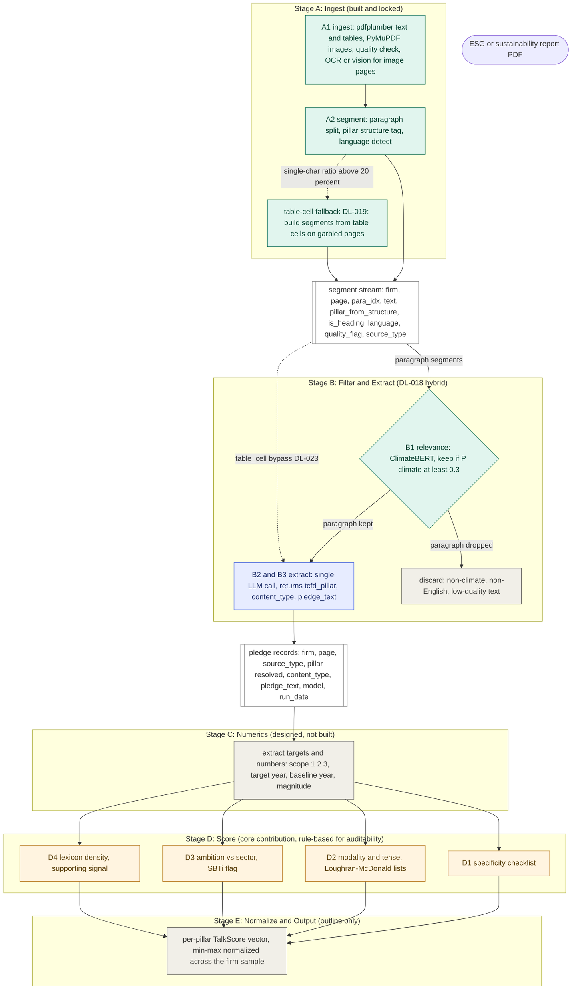

# TalkScore Pipeline Architecture

Scores climate pledge quality in ESG and sustainability reports of carbon-intensive HKEx-listed firms reporting under ISSB / IFRS S2. NUS Cognition X Lab, IRIS 2026.

Status at a glance: Stage A built and locked. Stage B is the DL-018 hybrid, with B1 coded (not yet run) and B2 not built. Stages C, D, E designed to varying depth. This file replaces the earlier tentative SVG, which froze the pre-DL-018 design (regex pillar tagger plus four-way router) and is now stale.

## Design philosophy

The pipeline is a chain of sub-tasks, in the shape P2 (Calamai et al. 2025) lays out for greenwashing NLP: locate relevant text, classify it, extract the claim, then score it.

The one real design bet sits inside Stage B (DL-018). The original plan classified structure with hand-built rules: a regex pillar tagger and a four-way content router. Across the first four firms those rules kept multiplying without converging, because every report broke them a new way (heading formats, spread layouts, goal-progress tables, garbled fonts). DL-018 replaced that machinery with a single LLM call. The grounding is P10 (Xu and Suzuki 2026), which shows an LLM doing zero-shot structured extraction from sustainability reports at 89.5 percent accuracy, good enough to absorb the structural variation in one step instead of many rules.

ClimateBERT is kept in front of the LLM as a cheap sieve (B1), because the binary climate-or-not question is exactly the task P1 (Bingler et al. 2022) validates it for, and it runs locally at no per-segment cost, so it thins the stream before the paid LLM call.

The counter-principle: Stage D scoring stays rule-based on purpose. The scoring rubric is the research contribution, so it has to be transparent and reproducible rather than a black box. That is the one place the LLM is deliberately kept out.

So the split is: deterministic ingestion (A), LLM for messy extraction (B), rule-based scoring (D). Colour in the diagram follows function, not just stage.

## Flowchart



Colour key: green is a deterministic local step (plain code or a local model like ClimateBERT), blue is an LLM call, amber is rule-based scoring (the contribution), grey is designed but not built, white is a data handoff between stages.

## Stages

### Stage A: Ingest (built and locked)
A1 pulls native text and tables with pdfplumber, embedded images with PyMuPDF, flags image-only or garbled pages, and sends image pages through OCR or a vision LLM. A2 splits pages into paragraphs, tags each with its TCFD pillar from the report's own headings (carry-forward), and detects language. DL-019 adds the table-cell fallback: on pages where extract_text output is garbled (single-char token ratio above about 20 percent), segments are built from the already-extracted table cells instead, which is what rescues content like Kunlun's Net Zero Roadmap. Key decisions: DL-001 to DL-008, DL-012, DL-015, DL-016, DL-019. Grounding: A2 pillar tagging follows the TCFD sentence-classification idea in P1.

### Stage B: Filter and Extract (DL-018 hybrid)
B1 is a ClimateBERT relevance sieve using climatebert/distilroberta-base-climate-detector. Rule-based routing first (drop non-English per DL-022, drop low-quality paragraph text, bypass table_cell segments straight to the LLM per DL-023), then a recall-leaning 0.3 threshold on the rest (DL-021). Kept segments go to B2, a single LLM call (GPT-4o or Claude Sonnet, chosen after the pilot) that returns tcfd_pillar, content_type, and pledge_text as JSON. The old B2 regex tagger and B3 router are gone, folded into that one call. Key decisions: DL-018, DL-020 to DL-024. Grounding: B1 on P1, B2 on P10.

Pillar resolution: A2's structural pillar wins when it is not Other; the LLM's tcfd_pillar is the fallback for un-headed text.

### Stage C: Numerics (designed, not built)
Extracts the quantitative side of a pledge from pledge_text and KPI tables: scope 1, 2, 3 coverage, target year, baseline year, and magnitude. This is the bridge to the actual-commitment side of the pledges-versus-actions gap. See the open question below on whether parts of this fold into the Stage B LLM call.

### Stage D: Score (core contribution, rule-based)
Four axes per pillar: D1 specificity (a checklist), D2 modality and tense (Loughran and McDonald 2011 modal word lists), D3 ambition (magnitude against the sector, SBTi flag), D4 lexicon density (a supporting signal only). Deliberately rule-based so every score is traceable to an explicit rule. P2 places specificity and stance as distinct scored sub-tasks, which is the shape D follows.

### Stage E: Normalize and Output (outline)
Assembles one TalkScore vector per firm per pillar, min-max normalized across the firm sample.

## Data contracts

Stage A hands Stage B a flat list of segments:

```python
{
  "firm": str,
  "page_num": int,
  "para_idx": int,
  "text": str,
  "pillar_from_structure": "Governance | Strategy | Risk Management | Metrics and Targets | Other",
  "is_heading": bool,
  "language": str,        # ISO 639-1 or "unknown"
  "quality_flag": str,    # "ok" | "likely_image_page" | "likely_garbled_ocr"
  "source_type": str      # "paragraph" | "table_cell"
}
```

Stage B hands Stage C and D a flat list of pledge records:

```python
{
  "firm": str,
  "page_num": int,
  "para_idx": int,
  "source_type": str,
  "pillar": str,          # resolved: A2 structure first, LLM tcfd_pillar as fallback
  "content_type": "pledge | kpi | time_series_kpi | materiality_matrix | boilerplate",
  "pledge_text": str,     # or null
  "model": str,           # LLM model and version
  "run_date": str         # YYYY-MM-DD
}
```

## Open design questions

These are not decided. Each needs its own decision-log entry before it goes into code.

1. Does part of Stage C fold into the Stage B LLM call? Under the DL-018 philosophy, net-zero detection and scope-coverage flagging are classification tasks the B2 LLM could return in the same JSON, leaving Stage C as pure numeric extraction. Worth deciding against pilot output rather than up front.
2. Modality in B2 or Stage D only? The B2 LLM could pre-extract the will-or-shall versus ongoing versus past signal in the same call (P10 already extracts modality this way), which saves a Stage D pass but mixes extraction and scoring. Current default is to leave modality to D2.
3. A separate net-zero detector? P11 (Schimanski et al., ClimateBERT-NetZero) is a candidate for a dedicated net-zero target detector, but P11 is not yet in the literature files and its claims are unverified (see DL-024). Revisit only if the pilot shows the single LLM call misses net-zero-specific pledges.

## File map

```
MODEL/
  Pipeline_Architecture.md        this file, replaces the stale SVG
  Stage_A/
    stage_a1_ingest.py
    stage_a2_segment.py
    Decision_Log_Stage_A.xlsx
    readme_stage_a.txt
  Stage_B/
    stage_b1_relevance.py         written, drop it here
    stage_b2_extract.py           the LLM layer, not built yet
    Decision_Log_Stage_B.xlsx
    readme_stage_b.txt            optional, to match Stage A
    EDA_Log.xlsx
```
